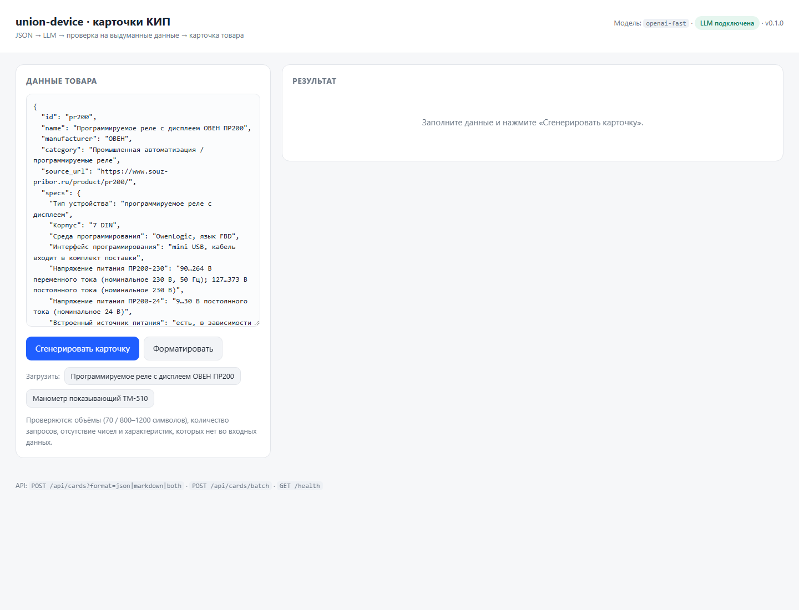

# union-device — AI-помощник для карточек КИП

Прототип сервиса для B2B-интернет-магазина контрольно-измерительных приборов:
на вход — структурированные данные прибора (JSON или веб-форма), на выход —
готовый черновик карточки товара.

Что формируется для каждого товара:

| Блок | Требование задания |
|---|---|
| SEO-заголовок | до 70 символов |
| SEO-описание | 800–1200 символов |
| Характеристики | структурированный список |
| Поисковые запросы | 3–5 штук |
| Commercial-блок | кому подходит и какие задачи решает |
| Чего не хватает | отсутствующие характеристики помечаются «данных нет» |

Главный принцип: **модель не имеет права выдумывать характеристики**. Это
обеспечивается не только промптом, но и детерминированной проверкой результата
кодом — см. раздел [«Три уровня защиты»](#три-уровня-защиты-от-выдуманных-данных).

## Стек

Python 3.11+, FastAPI, httpx (async), Pydantic v2, Jinja2, pytest.
Ни LangChain, ни базы данных, ни векторного поиска — по условиям задания это MVP,
который запускается одной командой.

## Быстрый старт

```bash
python -m venv .venv
# Windows: .venv\Scripts\activate
# Linux/macOS: source .venv/bin/activate
pip install -r requirements.txt

cp .env.example .env      # Windows: copy .env.example .env
# откройте .env и укажите LLM_API_KEY

uvicorn app.main:app --reload
```

Откройте http://127.0.0.1:8000 — там форма: вставьте JSON товара (или нажмите
кнопку с готовым товаром из `data/products/`) и получите карточку с вкладками
Markdown / JSON.

Без ключа сервис всё равно стартует: `/health` покажет
`"llm_configured": false`, а генерация вернёт 503 с понятным сообщением.

### Поддерживаемые провайдеры LLM

Один OpenAI-совместимый клиент — меняются только переменные окружения:

| Провайдер | `LLM_BASE_URL` | `LLM_MODEL` |
|---|---|---|
| OpenAI | `https://api.openai.com/v1` | `gpt-4o-mini` |
| OpenRouter | `https://openrouter.ai/api/v1` | `openai/gpt-4o-mini` |
| DeepSeek | `https://api.deepseek.com/v1` | `deepseek-chat` |
| Ollama (локально) | `http://localhost:11434/v1` | `qwen2.5:7b` |

Полный список переменных — в `.env.example`. Ключ читается только из окружения или
`.env`, который добавлен в `.gitignore`.

### Веб-форма



Слева — JSON товара (можно загрузить готовый из `data/products/`), справа —
результат с вкладками Markdown/JSON, статусом проверки достоверности, списком
недостающих характеристик и предупреждениями.

## Примеры результата

Готовые карточки для двух реальных товаров лежат в [`examples/`](examples):

| Товар | Файлы | Особенность |
|---|---|---|
| ОВЕН ПР200 — программируемое реле с дисплеем | [`examples/pr200.md`](examples/pr200.md), [`examples/pr200.json`](examples/pr200.json) | богатые данные: 20 характеристик, описание из техпаспорта |
| Манометр показывающий ТМ-510 (Манотомь) | [`examples/tm-510.md`](examples/tm-510.md), [`examples/tm-510.json`](examples/tm-510.json) | только таблица исполнений: нет класса точности, питания, корпуса — сервис честно помечает «данных нет» |

Фрагмент `examples/pr200.md`:

```markdown
## SEO-заголовок (42/70)
Программируемое реле ОВЕН ПР200 с дисплеем

## SEO-описание (1169 символов, норма 800–1200)
Программируемое реле ОВЕН ПР200 – компактное решение для локальной
автоматизации, предназначенное для задач водоподготовки, водоочистки,
вентиляции и отопления. Прибор размещается в корпусе 7 DIN и оснащён до 24
каналами аналогового и дискретного ввода/вывода …

## Характеристики
| Характеристика | Значение |
| --- | --- |
| Корпус | 7 DIN |
| Интерфейсы связи | до 2 × RS-485, протоколы Modbus RTU/ASCII, режим Master/Slave |
| Память | ПЗУ 128 кбайт, ОЗУ 32 кбайт, Retain 1016 байт |

## Чего не хватает в данных
- Класс точности / погрешность — данных нет
```

Пересобрать примеры: `python scripts/generate_examples.py`
(нужен `LLM_API_KEY`, занимает 1–3 минуты на два товара).

## Как это работает

```
JSON товара
   │
   ├─ validation.py    проверка и нормализация; при мусоре — 422 с описанием полей
   ├─ detect_gaps()    эвристика по чек-листу КИП: чего не хватает (диапазон,
   │                   класс точности, питание, интерфейсы, корпус, присоединение)
   │
   ├─ prompts.py       system: правила + формат; user: данные + список пропусков
   ├─ llm.py           POST /chat/completions: retries, backoff, JSON-mode,
   │                   один автоматический запрос на исправление битого JSON
   │
   ├─ factcheck.py     детерминированная проверка каждого значения и каждого числа
   │        │
   │        └─ нарушения? → один repair-запрос (модель видит список претензий)
   │
   ├─ sanitize()       удаление недоказанных характеристик, подгонка объёмов,
   │                   объединение пропусков, предупреждения контент-менеджеру
   │
   └─ render.py        Markdown для копирования + JSON для интеграции
```

### Промпт

Системный промпт (`app/prompts.py`) — это не «напиши красиво», а контракт:

* единственный источник фактов — блок «ДАННЫЕ ТОВАРА»; внешние знания использовать
  для фактов запрещено;
* запрещено округлять, пересчитывать единицы, добавлять сертификаты, гарантию,
  аналоги, степень защиты, страну происхождения;
* отсутствующая характеристика → «данных нет» + пункт в `data_gaps`;
* жёсткая структура описания (назначение → характеристики → задачи и отрасли →
  на что смотреть при выборе) и объёмы (70 / 800–1200 / 3–5 / 300–600);
* ответ — строго JSON по схеме, которая продублирована в промпте.

Пользовательское сообщение содержит нормализованный JSON товара и отдельный блок
«ЧЕГО НЕТ ВО ВХОДНЫХ ДАННЫХ» — список пропусков, найденных кодом, с подсказкой,
как его трактовать. Из-за этого модель не «додумывает» класс точности манометра,
а пишет про него в `data_gaps`.

Repair-промпт (второй вызов) получает черновик и пронумерованный список нарушений —
модель исправляет только их и не добавляет новых фактов.

## Три уровня защиты от выдуманных данных

1. **Промпт** — явные запреты и формат, где для выдумки нет места.
2. **Детерминированная проверка** (`app/factcheck.py`) — не доверяет модели:
   * каждая пара «характеристика → значение» должна быть подтверждена входными
     данными: значение целиком собирается из текста входа, а название
     характеристики хотя бы наполовину совпадает по основам слов с данными;
   * каждое число в заголовке, описании, commercial-блоке и запросах обязано
     встречаться во входных данных (ловит «с 1998 года», «IP65», «класс 1,5»);
   * характеристики из списка пропусков не могут получить значение — только
     «данных нет»;
   * объёмы, количество запросов, уникальность, язык проверяются по факту.
3. **Sanitize + отчёт** — если после repair-запроса нарушения остались, спорные
   характеристики удаляются, объёмы подрезаются по границе предложения, а в
   карточке остаются предупреждения и `fact_check.passed = false`. Выдумка не
   попадает в результат ни при каком поведении модели.

Проверка намеренно не пытается «понять» смысл: она сравнивает строки и числа.
Это делает её предсказуемой и тестируемой; цена — редкие ложные срабатывания на
сильно перефразированных значениях, которые лечатся repair-запросом.

## Входные данные

```json
{
  "id": "tm-510",
  "name": "Манометр показывающий ТМ-510",
  "manufacturer": "Манотомь",
  "category": "Теплотехнические приборы / манометры показывающие",
  "source_url": "https://www.souz-pribor.ru/product/tm-510/",
  "specs": {
    "Резьба присоединения": "G1/2; М20×1,5",
    "Расположение штуцера": "радиальное; осевое"
  },
  "description": "фрагмент техпаспорта — необязательно"
}
```

| Поле | Обязательно | Поведение |
|---|---|---|
| `name` | да | короче 2 символов → 422 |
| `manufacturer` | нет | отсутствует → попадает в пропуски, в карточке «данных нет» |
| `specs` | нет | числа/списки/`true` нормализуются в строки, пустые значения отбрасываются |
| `description` | нет | длиннее 8000 символов — обрезается с пометкой в метаданных |
| `id`, `category`, `source_url` | нет | попадают в карточку как есть |

Ошибочные данные не роняют сервис: пустое имя, не-объект, `specs`-массив,
битый JSON → 422 с перечнем проблемных полей.

## API

| Метод | Путь | Назначение |
|---|---|---|
| `GET` | `/` | веб-форма |
| `GET` | `/health` | статус, настроен ли ключ, модель |
| `GET` | `/api/example[?product=pr200]` | пример входных данных |
| `POST` | `/api/cards?format=json\|markdown\|both` | карточка по одному товару |
| `POST` | `/api/cards/batch` | до 10 товаров, ошибки по каждому отдельно |

```bash
curl -s localhost:8000/api/cards?format=markdown \
  -H 'Content-Type: application/json' \
  --data-binary @data/products/pr200.json
```

Единый формат ошибок:

```json
{"error": {"code": "invalid_input", "message": "Некорректные входные данные",
           "details": {"issues": [{"field": "name", "message": "название обязательно"}]}}}
```

| Код | HTTP | Когда |
|---|---|---|
| `invalid_input` | 422 | пустые/некорректные поля, битый JSON |
| `llm_not_configured` | 503 | не задан `LLM_API_KEY` |
| `llm_auth` | 502 | ключ отклонён провайдером |
| `llm_rate_limit` | 429 | лимит запросов |
| `llm_timeout` | 504 | провайдер не ответил |
| `llm_unavailable`, `llm_bad_request`, `llm_invalid_json` | 502 | ошибки провайдера и ответ не по схеме |

## CLI

```bash
python scripts/generate_examples.py                       # все товары из data/products
python scripts/generate_examples.py --input data/products/tm-510.json --format markdown
```

Скрипт печатает отчёт по каждому товару (длины, число характеристик, статус
проверки, предупреждения), пишет файлы в `examples/` и возвращает ненулевой код,
если хотя бы один товар не сгенерирован.

## Тесты

```bash
python -m pytest -q     # 64 теста, сеть не нужна
```

Покрыто: валидация и нормализация входа, определение пропусков, разбор и repair
JSON, retry/таймауты/коды ошибок LLM-клиента (через `httpx.MockTransport`),
детекция выдуманных характеристик и чисел, подгонка объёмов, оркестрация с
подменённым клиентом, HTTP-эндпоинты, рендеринг Markdown/JSON.

## Данные и источник

Товары взяты с сайта «Союз-Прибор» — ОВЕН ПР200 и манометр ТМ-510.

Прямой доступ к `https://www.souz-pribor.ru/yml/any/feed.xml` с машины разработки
блокируется на уровне TLS: DNS и TCP проходят, TLS-handshake завершается
таймаутом (проверены `curl`, `python ssl`, `node fetch`, публичные CORS-прокси —
522/429). Поэтому данные сняты с товарных страниц сайта, а сырые ответы сохранены
в [`data/raw/`](data/raw) — каждое значение в карточке можно сверить с источником.
Подробности — в [`data/raw/README.md`](data/raw/README.md).

Если фид доступен в вашей сети, входные JSON удобно получать из него: структура
`data/products/*.json` намеренно повторяет поля YML (`name`, `vendor`,
`description`, `param`).

## Принятые решения

| Решение | Почему |
|---|---|
| Свой клиент на `httpx` вместо SDK вендора | провайдер меняется одной переменной окружения, нет лишней зависимости, полный контроль над retries и таймаутами |
| JSON-режим + один repair-запрос на битый JSON | дешевле и надёжнее, чем парсить «почти JSON» регулярками |
| Детерминированный фактчек вместо «второй модели-судьи» | проверка воспроизводима, объяснима, бесплатна и покрыта тестами |
| Repair-запрос с перечнем нарушений | модель исправляет конкретику, а не переписывает карточку заново |
| Sanitize как последний рубеж | даже при игнорировании промпта выдумка не попадёт в результат |
| FastAPI + одна HTML-страница | минимальный, но рабочий UI для контент-менеджера; JSON API — для интеграции с CMS |
| Нет БД и очередей | по условиям задания это MVP на 2–4 часа |

## Ограничения

* **Фактчек эвристический.** Он сравнивает строки и числа, а не смысл: возможны
  ложные срабатывания на сильно перефразированных значениях (лечатся repair-запросом)
  и пропуск «мягких» домыслов без чисел («автономная работа», «универсальный»).
* **Источник данных — страницы, а не фид** (см. выше); у ТМ-510 на странице нет
  описания и класса точности, поэтому карточка честно сообщает об этом.
* **Цены, наличие и сроки поставки** намеренно не генерируются: они меняются и не
  относятся к контентной карточке.
* **Поисковые запросы** не проверяются по частотности — это черновик для
  контент-менеджера, а не готовый семантический кластер.
* **Один товар — один запрос**, без кэша и параллельной обработки батча.
* Примеры в `examples/` сгенерированы бесплатной reasoning-моделью
  (`gpt-oss-20b` через OpenAI-совместимый шлюз) с `reasoning_effort=low`: на
  платной модели того же класса текст будет ровнее при том же промпте. Время в
  метаданных примеров — фактическое время прогона; шлюз кэширует повторные
  запросы, поэтому у вас первый запрос займёт 25–60 секунд.

## Что можно улучшить дальше

1. Загрузчик YML-фида (`scripts/from_yml_feed.py`) и дедупликация товаров.
2. Проверка «мягких» домыслов: список рискованных формулировок + LLM-судья на
   отдельном проходе только для спорных фрагментов.
3. Кэш ответов и учёт стоимости токенов на карточку.
4. Семантический кластер запросов вместо 3–5 строк.
5. Публикация в CMS через webhook и хранение версий карточки.
6. Оценка качества описания (читаемость, переспам ключей) перед публикацией.

## Структура репозитория

```
app/
  config.py      настройки из env, загрузка .env, extra-параметры провайдера
  models.py      входные данные и модели карточки
  normalize.py   нормализация текста и чисел
  validation.py  проверка входа, поиск пропусков
  prompts.py     системный, пользовательский и repair-промпты
  llm.py         OpenAI-совместимый клиент
  factcheck.py   проверка на выдуманные данные и sanitize
  generator.py   оркестрация пайплайна
  render.py      Markdown / JSON
  main.py        FastAPI-приложение
  templates/     веб-форма
data/products/   входные данные двух товаров
data/raw/        снимки страниц-источников
examples/        результаты генерации
scripts/         CLI-генератор
tests/           pytest
```

## С какими сложностями столкнулся

1. **Фид недоступен из моей сети** — TLS-handshake до `souz-pribor.ru` зависает,
   хотя DNS и TCP работают; публичные прокси отдают 522/429. Обошёл чтением
   товарных страниц и сохранил снимки в `data/raw/`, чтобы проверяющий мог
   сверить данные.
2. **Соблазн выдумки сильнее, чем кажется.** Первый прогон модели дописал
   манометру «класс точности 1,5» и «диаметр корпуса 160 мм». Пришлось добавить
   проверку не только значений, но и названий характеристик — иначе «1,5»
   проходило проверку, потому что встречалось в резьбе М20×1,5.
3. **Формат ответа.** Reasoning-модели иногда тратят весь бюджет токенов на
   рассуждения и не отдают JSON; выручили JSON-mode, repair-запрос и явный
   `reasoning_effort=low` для бесплатного шлюза.
4. **Баланс строгости фактчека.** Слишком строгая проверка удаляет нормальные
   перефразированные подписи («Интерфейсы связи» вместо «Интерфейс RS-485»);
   решил сравнением по основам слов с порогом «половина слов названия».
